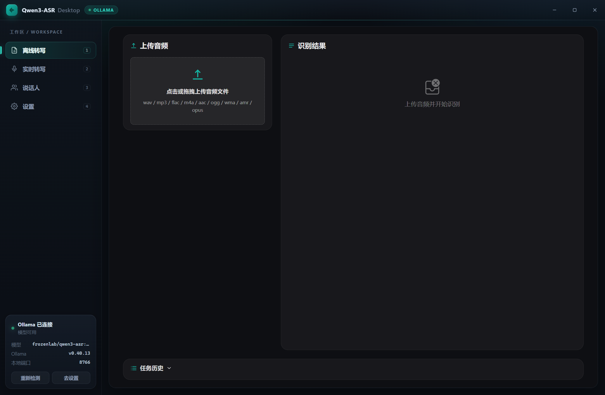

# Qwen3-ASR Desktop（便携版）

基于开源项目 **[LanceLRQ/qwen3-asr-service](https://github.com/LanceLRQ/qwen3-asr-service)** 的 Windows x86 便携式桌面客户端。

直接复用上游的 **Vue 3 + Naive UI** Web 界面（离线转写 / 实时转写 / 说话人 / 文档导航），
外层用 **Electron** 提供自定义标题栏与侧边栏外壳，把上游的 FunASR + PyTorch 推理链路替换为
**Ollama 上的 Qwen3-ASR**，因此：

- 不需要安装 CUDA / PyTorch / FunASR，也不需要下载多 GB 的模型权重；
- 只要本机或局域网里有 Ollama + `qwen3-asr` 模型即可使用；
- 打包后是**免安装目录**，拷到任意 Windows x86 电脑双击即可运行。



```
┌────────────────────────────────────────────────────────┐
│ Electron 外壳（自绘标题栏 + 侧边栏 + 状态卡片）           │
│   ├─ /app 外壳页面                                       │
│   └─ iframe → /web-ui?embed=1（上游 Vue UI，暗色嵌入）    │
├────────────────────────────────────────────────────────┤
│ 本地 FastAPI 服务 :8765（v2 接口 / WebSocket / 设置 API） │
│   └─ Ollama 客户端（OpenAI 兼容 + /api/chat 回退）        │
└────────────────────────────────────────────────────────┘
                     │ HTTP
                     ▼
      Ollama: frozenlab/qwen3-asr:1.7b
      /v1/audio/transcriptions  ·  /api/chat
```

---

## 1. 功能

| 功能 | 状态 | 说明 |
|---|---|---|
| 离线文件转写 | ✅ | 支持 WAV/MP3/FLAC/M4A/AAC/OGG/WMA/AMR/OPUS，提交任务 + 轮询结果 |
| 实时麦克风转写 | ✅ | 边说边出字：说话过程中持续推送增量结果（partial），停顿后自动定稿为整句（final） |
| 文件模拟推流 | ✅ | 上游实时页自带的「用音频文件模拟推流」同样可用 |
| 任务历史 / 取消 / 删除 | ✅ | 结果持久化到 `data/tasks.json`，重启后仍可查看 |
| 时间轴 / 分段结果 / JSON | ✅ | 由 Ollama `verbose_json` 的分段直接映射 |
| 标点与语种 | ✅ | 模型自带标点；自动检测语种（也可在设置里指定默认语言） |
| 空闲内存回收 | ✅ | 空闲时通过 `keep_alive=0` 卸载模型，也可手动「立即释放」 |
| 说话人分离 / 声纹库 | ❌ | Ollama 版不提供，界面会隐藏对应开关（接口返回 503） |
| 音频事件标注 | ❌ | 同上 |

## 2. 快速开始

### 2.1 准备 Ollama 与模型

```powershell
# 1) 安装 Ollama for Windows：https://ollama.com/download
# 2) 拉取 Qwen3-ASR 模型（0.6b 更快，1.7b 更准）
ollama pull frozenlab/qwen3-asr:1.7b

# 3) 确认服务已启动
curl http://127.0.0.1:11434/api/version
```

> 该模型需要 Ollama ≥ 0.40（支持音频输入 / `qwen3a` 投影器）。若使用旧版，程序会尝试
> 自动回退到 `/api/chat` + `images` 的方式。

### 2.2 启动程序

**开发模式（Electron + 源码后端）**

```powershell
# 后端依赖
python -m venv .venv
.venv\Scripts\python -m pip install -r requirements.txt

# Electron 依赖（需要 Node.js LTS）
cd electron
npm install
node node_modules\electron\install.js     # npm 11 默认拦截安装脚本时手动下载 Electron
$env:QWEN3ASR_BACKEND = "source"           # 使用源码后端，便于改代码
npm start
```

也可以直接双击根目录的 `run.bat`（会自动识别已安装的 Electron）。

**打包便携版（免安装）**

```powershell
powershell -ExecutionPolicy Bypass -File .\build_electron.ps1
# 产物：
#   release\win-unpacked\                                  免安装目录
#   release\Qwen3-ASR-Desktop-portable-win-x64-v1.0.0.zip  便携 zip（约 206 MB）
```

`release\win-unpacked` 整个目录即为便携包；同时会生成 zip，解压后双击
`Start.bat` 或 `Qwen3-ASR Desktop.exe` 即可运行。其中已包含 Python 后端
（`resources\backend`）、ffmpeg 与 Electron 运行时，目标机无需安装 Python / Node。
仅用浏览器的精简打包：`build_portable.ps1`（产物 `dist\Qwen3-ASR-Desktop`，双击后以 Edge 应用窗口打开）。

启动后左侧边栏切换「离线转写 / 实时转写 / 说话人 / 设置」，右下角状态卡片实时显示 Ollama 连接情况。

## 3. 设置页

| 设置项 | 默认值 | 说明 |
|---|---|---|
| 服务地址 | `http://127.0.0.1:11434` | Ollama 地址，可填局域网 IP |
| 模型 | `frozenlab/qwen3-asr:1.7b` | 支持「刷新列表」拉取本机已下载模型 |
| 接口模式 | OpenAI 兼容 | 新版用 `/v1/audio/transcriptions`；404 时切到 `/api/chat` |
| 默认识别语言 | 自动检测 | 主界面未传语言时使用 |
| 请求超时 | 300 秒 | 长音频可调大 |
| 实时转写 | 开启 | 关闭后 `/v2/asr/stream` 返回 1011 |
| 断句静音 | 700 ms | 越小定稿越快，越大越不容易截断长句 |
| 最短语音 | 250 ms | 过滤咳嗽等短噪声 |
| 最长分段 | 12 秒 | 防止单段超过模型窗口 |
| 增量结果间隔 | 700 ms | 说话过程中每隔该时长刷新一次临时文字，越小越实时、越耗算力 |
| 语音门限 | -45 dBFS | 嘈杂环境建议 -40，安静环境 -50 |
| ffmpeg 路径 | 自动查找 | 非 WAV 格式需要 ffmpeg；`pip install imageio-ffmpeg` 也会被自动识别 |
| 本地端口 | 8765 | 修改后需重启；被占用时自动顺延 |
| 空闲自动卸载模型 | 关闭 | 空闲超过设定秒数即卸载模型（`keep_alive=0`），服务保持运行 |
| 空闲判定 | 300 秒 | 仅统计真实识别活动，健康检查不会重置计时 |

配置保存在程序目录的 `settings.json`（便携）；若目录不可写则退回到 `%APPDATA%`。

## 4. 目录结构

```
qwen3-asr-desktop/
├─ app.py                     # 后端入口：启动本地服务（可写 runtime.json 供 Electron 读取）
├─ asr_desktop/
│  ├─ settings.py             # 设置读写 / 语言表 / 不可写目录回退
│  ├─ audio.py                # ffmpeg 查找、WAV 解析、重采样
│  ├─ ollama.py               # Ollama 客户端（OpenAI 兼容 + /api/chat 回退 + 模型卸载）
│  ├─ tasks.py                # 离线任务队列 + tasks.json 持久化
│  ├─ streaming.py            # 实时流能量 VAD 分段（增量 + 定稿）
│  ├─ server.py               # FastAPI：v2 接口 / WebSocket / 设置与内存 API
│  ├─ desktop.py              # 非 Electron 场景：Edge 应用窗口 / WebView2 / 浏览器回退
│  └─ web/
│     ├─ shell.html           # ← Electron 外壳（自绘标题栏 + 侧边栏 + 状态卡片）
│     └─ index/stream/speakers/settings.html + assets/  # ← 复用上游 UI（仅加 embed 支持）
├─ electron/
│  ├─ main.js                 # 启动后端子进程、创建无边框窗口、窗口控制 IPC
│  ├─ preload.js              # contextBridge 暴露 window.desktop
│  ├─ package.json            # electron-builder 配置（extraResources 打入后端）
│  └─ assets/icon.ico
├─ build_portable.ps1         # 仅打包 Python 后端（PyInstaller onedir）
├─ build_electron.ps1         # 后端 + Electron 一起打包为便携目录 + zip
├─ run.bat
├─ requirements.txt
└─ data/                      # 运行时生成：app.log / tasks.json / uploads/
```

## 5. 与上游接口的对应关系

| 上游接口 | 本实现 | 说明 |
|---|---|---|
| `GET /v2/health` | ✅ | 额外返回 `ollama_version` / `message` 等字段 |
| `GET /v2/capabilities` | ✅ | `stream.enabled` 由设置控制；说话人/标注相关能力为 false |
| `POST /v2/asr` | ✅ | multipart 提交，返回 `task_id` |
| `GET /v2/tasks` `{id}` | ✅ | 支持 `history` / `status` / `limit` |
| `DELETE /v2/tasks/{id}` | ✅ | 取消或删除记录 |
| `WS /v2/asr/stream` | ✅ | `start` / 二进制 PCM / `stop`；`final` 逐句返回 |
| `POST /v2/audio/tag` | 503 | 未实现（UI 已按能力隐藏） |
| `/v2/speakers*` | 503 | 未实现（UI 已按能力隐藏） |
| `GET /app` | ➕ 新增 | Electron 外壳页面（标题栏 + 侧边栏 + 内嵌上游 UI） |
| `GET/POST /api/settings` | ➕ 新增 | 便携版设置页使用 |

## 6. 已知限制

- Ollama 的转写模型单次窗口约 30–60 秒；离线接口由 Ollama 自动切分，超长音频会更慢。
- 实时转写为「能量 VAD + 周期性增量识别」：说话过程中每 ~0.9s 会把当前累积音频送去识别并刷新临时文字，
  停顿 700ms 后定稿；实际出字延迟取决于硬件——CPU 上 1.7b 每次约 2–4s，建议实时场景改用 0.6b 或启用 GPU。
- 词级时间戳、说话人分离、声纹识别、音频事件标注依赖上游的 FunASR 模型，本便携版不包含。
- Electron 外壳通过 iframe 内嵌上游页面（同源，支持麦克风）；若只想用浏览器，可运行 `build_portable.ps1` 产出的版本。
- 「关闭 Ollama 服务」默认采用卸载模型的方式（`keep_alive=0`），不会影响系统里其它用到 Ollama 的程序。
- 首次启动 Electron 便携包时 Windows 可能弹出「防火墙/网络」提示，仅监听 `127.0.0.1`，拒绝即可。

## 7. 许可

- 本项目代码：MIT。
- `asr_desktop/web/` 来自 [LanceLRQ/qwen3-asr-service](https://github.com/LanceLRQ/qwen3-asr-service)（MIT），
  改动仅限于：新增设置入口/设置页、`embed=1` 内嵌模式、新增 Electron 外壳页 `shell.html`。
- Qwen3-ASR 模型与 GGUF 转换版权归各自作者所有，详见 `THIRD_PARTY_NOTICES.md`。
